# Data Architecture & Persistence Layer

The persistence layer contains 16 PostgreSQL tables across identity, workflow, audit, notifications, and work packages, plus two MongoDB collections for dynamic forms. PostgreSQL schema changes are managed with Flyway and accessed through jOOQ; MongoDB documents use Spring Data's `MongoTemplate`.

## Database Configuration

| Service/Module | DB Type | Profile | Driver | Connection | Migration Tool |
|---|---|---|---|---|---|
| Core identity, workflow, work packages, audit, notifications | PostgreSQL | local (default), dev, prod | PostgreSQL JDBC driver; Spring Boot default HikariCP auto-configuration, no explicit pool sizing found | Environment-resolved JDBC URL and credentials | Flyway, migrations V1-V5 |
| Dynamic form schemas and submissions | MongoDB | local, dev, prod when configured for Mongo | Spring Data MongoDB driver | Environment-resolved MongoDB URI and database | No Mongo migration tool or explicit index-creation routine found |
| Offline form-submission fallback | PostgreSQL JSONB | Any profile configured to use the PostgreSQL form store | PostgreSQL JDBC driver | Same PostgreSQL connection | Flyway V1 creates `form_documents` |
| jOOQ code generation parser | H2 DDLDatabase parser | Build/code generation only | H2 | Parses Flyway SQL files; not a runtime application database | jOOQ `DDLDatabase` |

The local profile defaults to MongoDB for forms and filesystem attachment storage. Dev uses MongoDB and MinIO. Prod requires a MongoDB URI and disables seed data; its form store remains configurable. No custom connection-pool limits, server-side cache provider, or Mongo collection indexes were identified in the inspected source. Attachment bytes live outside the databases (MinIO or local filesystem); PostgreSQL stores attachment metadata.

## Data Ownership per Service

| Service | Tables / Collections Owned | ORM Framework | Caching | Notes |
|---|---|---|---|---|
| Identity | `users`, `roles`, `user_roles`, `user_admin_audit_logs` | jOOQ | None found | Role membership is a normalized join table; account administration audit is in PostgreSQL. |
| Workflow | `workflow_definitions`, `workflow_nodes`, `workflow_transitions`, `workflow_instances`, `inspection_records`, `audit_logs`, `form_documents` | jOOQ | None found | `form_documents` is the PostgreSQL-only form fallback. Workflow definitions currently persist both JSON and normalized graph rows. |
| Work packages | `work_packages`, `work_package_parts` | jOOQ | None found | A part can select its own workflow definition and optionally link to a workflow instance. |
| Notifications | `workflow_notifications`, `notification_reads` | jOOQ | None found | Read state is per user and notification. Target role is stored as a string. |
| Forms | MongoDB `form_schemas`, `form_submissions`; fallback `form_documents` is owned by Workflow | Spring Data `MongoTemplate` / jOOQ fallback | None found | MongoDB is the configured dynamic-form store; PostgreSQL fallback is selected by configuration. |
| Analytics | No owned tables; reads workflow and inspection data | jOOQ via `WorkflowRepository` and `DSLContext` | None found | Current analytics aggregation is application-side and reads the same primary database. |
| Attachments | Object bytes in MinIO or local filesystem; PostgreSQL `documents` metadata is written through `WorkflowRepository` | jOOQ metadata / MinIO client or filesystem | None found | Attachment authorization is enforced in application services; object storage is not a relational entity. |

## Entity Model

The relational model normalizes users and roles, work-package headers and parts, and per-user notification read state. The ER diagram shows enforced PostgreSQL foreign keys; string references such as audit-log actors and workflow node keys are intentionally not drawn as enforced relationships. MongoDB collections are shown separately because their IDs do not participate in PostgreSQL foreign keys.

```mermaid
erDiagram
    Users ||--o{ UserRoles : "has role links"
    Roles ||--o{ UserRoles : "assigned through"
    WorkflowDefinitions ||--o{ WorkflowNodes : "defines nodes"
    WorkflowDefinitions ||--o{ WorkflowTransitions : "defines transitions"
    WorkflowDefinitions ||--o{ WorkflowInstances : "runs instances"
    WorkflowDefinitions o|--o{ WorkPackages : "default workflow"
    WorkflowDefinitions ||--o{ WorkPackageParts : "selected for part"
    WorkPackages ||--o{ WorkPackageParts : "contains parts"
    WorkflowInstances ||--o{ InspectionRecords : "has inspection records"
    WorkflowInstances ||--o{ Documents : "has attachment metadata"
    WorkflowInstances ||--o{ FormDocuments : "has fallback submissions"
    WorkflowInstances ||--o{ WorkflowNotifications : "generates notifications"
    WorkflowInstances o|--o{ WorkPackageParts : "linked from part"
    WorkflowNotifications ||--o{ NotificationReads : "has read state"
    Users ||--o{ NotificationReads : "reads notifications"
    Users o|--o{ WorkflowInstances : "starts instances"
    Users o|--o{ InspectionRecords : "records inspections"
    Users o|--o{ Documents : "uploads attachments"
    Users o|--o{ FormDocuments : "creates submissions"
    Users o|--o{ WorkPackages : "creates packages"
    Users o|--o{ UserAdminAuditLogs : "acts in administration"
    Users ||--o{ UserAdminAuditLogs : "is administration target"
    FormSchemas {
        objectid id PK
        string formKey
        string name
        json fields
        string status
        int version
    }
    FormSubmissions {
        string id PK
        string instanceId
        string formKey
        string nodeKey
        string payloadJson
        string createdBy
        datetime createdAt
    }
    Users {
        uuid id PK
        string username UK
        string passwordHash
        string displayName
        boolean active
        boolean mustChangePassword
        datetime createdAt
    }
    Roles {
        uuid id PK
        string code UK
        string name
    }
    UserRoles {
        uuid userId PK "composite PK; FK to Users"
        uuid roleId PK "composite PK; FK to Roles"
    }
    WorkflowDefinitions {
        uuid id PK
        string key UK
        string name
        int version
        boolean active
        jsonb definitionJson
    }
    WorkflowNodes {
        uuid id PK
        uuid definitionId FK
        string nodeKey
        string nodeType
        string roleCode
        string formKey
        jsonb configJson
    }
    WorkflowTransitions {
        uuid id PK
        uuid definitionId FK
        string fromNodeKey
        string toNodeKey
        string conditionValue
        int priority
    }
    WorkflowInstances {
        uuid id PK
        uuid definitionId FK
        string businessKey
        string status
        string currentNodeKey
        jsonb contextJson
        uuid startedBy FK
    }
    InspectionRecords {
        uuid id PK
        uuid instanceId FK
        string nodeKey
        string result
        uuid recordedBy FK
        datetime recordedAt
    }
    Documents {
        uuid id PK
        uuid instanceId FK
        string nodeKey
        string storageKey
        uuid uploadedBy FK
        datetime uploadedAt
    }
    AuditLogs {
        uuid id PK
        uuid instanceId
        uuid userId
        string action
        jsonb payloadJson
        datetime createdAt
    }
    FormDocuments {
        uuid id PK
        uuid instanceId FK
        string formKey
        string nodeKey
        jsonb payloadJson
        uuid createdBy FK
    }
    WorkflowNotifications {
        uuid id PK
        uuid instanceId FK
        string targetRole
        string title
        datetime createdAt
    }
    NotificationReads {
        uuid notificationId PK "composite PK; FK to WorkflowNotifications"
        uuid userId PK "composite PK; FK to Users"
        datetime readAt
    }
    WorkPackages {
        uuid id PK
        string packageNo UK
        string aircraftId
        string poNumber
        string soNumber
        uuid workflowDefinitionId FK
        string status
        uuid createdBy FK
    }
    WorkPackageParts {
        uuid id PK
        uuid packageId FK
        int sequenceNo
        string partNo
        string serialNo
        uuid workflowDefinitionId FK
        uuid instanceId FK
        string status
    }
    UserAdminAuditLogs {
        uuid id PK
        uuid actorUserId FK
        uuid targetUserId FK
        string action
        jsonb changesJson
        datetime createdAt
    }
```

<!-- mermaid-checked: every attribute is `<type> <name> [<key>] ["<description>"]` with at most one of PK/FK/UK, no \n in descriptions, no {} in descriptions, every relationship label is double-quoted -->

**Normalization assessment (3NF):** The identity and work-package structures are substantially normalized, and `user_roles` / `notification_reads` correctly represent many-to-many membership and per-user read state. The schema cannot be certified as consistently 3NF from migrations alone: `workflow_definitions.definition_json` duplicates graph information represented in `workflow_nodes` and `workflow_transitions`, and audit, node-key, and role-code references are not uniformly constrained. JSON payloads used as versioned form/context documents are reasonable aggregate storage; they are not evidence of a 3NF violation by themselves. The workflow graph's dual representation is the primary update-anomaly risk. “3N” is interpreted here as third normal form; the application also has a conventional UI/API/data-store separation, but is implemented as a modular monolith rather than three independently deployed tiers.

## Key Repository Methods

| Service | Repository | Notable Methods | Purpose |
|---|---|---|---|
| Identity | `UserRepository` — `server/src/main/java/com/hal/amms/identity/UserRepository.java` | `findByUsername`, `findById`, `replaceRoles`, `linkRole`, `listRoleCodes` | Login/account lookup and role assignment. Role codes are resolved through the normalized roles join. |
| Identity administration | `UserAdminRepository` — `server/src/main/java/com/hal/amms/identity/UserAdminRepository.java` | `findUsers(offset, limit, active, roleCode, search)`, `countUsers`, `countActiveAdmins`, `insertAudit` | Filtered/paged user search, role-aware administration, and audit writes. Role data for a page is bulk-loaded. |
| Workflow | `WorkflowRepository` — `server/src/main/java/com/hal/amms/workflow/WorkflowRepository.java` | `listDefinitions`, `findDefinitionByKey`, `upsertDefinition`, `nodesFor`, `transitionsFrom`, `listInstances`, `auditsFor`, `latestFormPayload`, `latestPassFailResult`, `userParticipated` | Definition/graph persistence, instance reads, audit/form history, inspection outcomes, and participation checks. `upsertDefinition` updates JSON and rebuilds normalized graph rows. |
| Work packages | `WorkPackageRepository` — `server/src/main/java/com/hal/amms/workpackage/WorkPackageRepository.java` | `listPackages`, `partsFor`, `nextSequence`, `findPartByInstance`, `linkPartInstance` | Package and part retrieval, ordering, sequence allocation, and instance linkage. |
| Notifications | `NotificationRepository` — `server/src/main/java/com/hal/amms/notification/NotificationRepository.java` | `listForRoles(roles, userId, limit)`, `markRead` | Bounded role-targeted notification list with per-user read-state check and idempotent mark-read. |
| Forms | `MongoFormSchemaService` / `MongoFormSubmissionStore` — `server/src/main/java/com/hal/amms/forms/` | Schema lookup by `formKey`; `findLatest(instanceId, nodeKey, formKey)` | Dynamic schema lifecycle and latest submission retrieval. Mongo indexes beyond the implicit `_id` index were not found. |
| Analytics | `AnalyticsService` — `server/src/main/java/com/hal/amms/analytics/AnalyticsService.java` | `forUser` | Computes role metrics from instances and inspection records. It currently loads all instances, filters in memory, and repeatedly resolves definitions/nodes. |

Workflow service mutations use Spring transactions around PostgreSQL operations. MongoDB form submissions are written through a separate store and do not share an atomic transaction with PostgreSQL state changes.

## Caching Strategy

No server-side cache provider, TTL, cache region, or caching annotation was found. PostgreSQL and MongoDB are read directly. The UI uses TanStack Query for server-state caching, but that is client-side cache behavior, not a shared or durable database cache. Current database access patterns should be measured before introducing Redis or query caching; first bound query result sets and remove repeated reads in analytics and instance-list paths.

## Data Ownership Boundaries

The backend is a package-by-feature modular monolith using one PostgreSQL database for identity, workflow, work packages, notifications, and audit. MongoDB is a separate shared store for dynamic form schemas/submissions; attachment binary objects are in MinIO or local filesystem storage, with metadata in PostgreSQL. There is no database-per-service or read-replica boundary in the inspected configuration.

Feature repositories access shared PostgreSQL tables directly through jOOQ. Analytics composes workflow repository reads with direct jOOQ inspection counts. Form persistence is abstracted by `FormSubmissionStore`, but PostgreSQL workflow state and MongoDB form submissions cannot commit atomically. No outbox or reconciliation process was identified. MongoDB form documents reference PostgreSQL instances and users using string identifiers without relational constraints. Cross-store consistency, idempotency, and orphan cleanup therefore need explicit operational handling.

### Data Classification & Sensitivity

| Entity | Sensitive Fields | Classification (PII/PHI/PCI/None) | Controls in Place |
|---|---|---|---|
| `users` | `username`, `display_name`, `password_hash` | PII; credential material | Password is stored as a hash. Authentication and authorization exist at the application layer. No database field-level encryption or masking configuration was found. |
| `user_admin_audit_logs`, `audit_logs` | Actor/target identifiers, action history, JSON payloads | PII-bearing audit data; potentially sensitive operational data | Application-level audit writes exist. `audit_logs` has no declared FK to users/instances and database-level append-only enforcement was not identified. |
| `workflow_instances`, `inspection_records`, `work_package_parts`, `work_packages` | Work-order identifiers, aircraft identifiers, part/serial numbers, outcomes, notes, JSON context | Controlled/proprietary maintenance data; may include user identifiers | Workflow and instance authorization is implemented in the application. No database classification labels, masking, or field-level encryption were found. |
| `form_schemas`, `form_submissions`, `form_documents` | Dynamic field definitions and submitted payloads; signature fields are supported | Potential PII and controlled maintenance data; contents depend on configured forms | Access is mediated by application services. No MongoDB index/retention policy or field-level encryption configuration was identified. |
| `documents` and object storage | File name, storage key, uploader, attachment bytes | Potential PII and controlled maintenance data; file-dependent | Application attachment ACL is present. Encryption at rest and retention controls depend on deployment and were not verifiable from source. |

